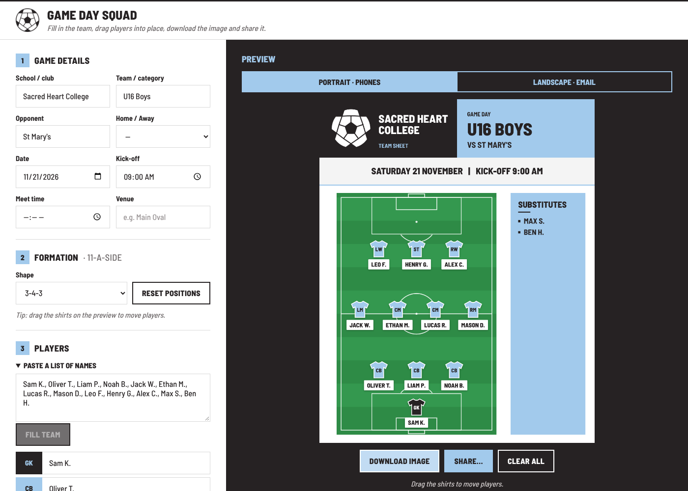

# Game Day Squad ⚽

A web app for school soccer coaches. Enter the game details and players, set the formation, and download a team sheet image ready to share with parents and staff.

**[Live demo →](https://game-day-squad.gutierrezjuanni.workers.dev)**

<!-- Tip: replace with a short GIF of dragging players and downloading the image -->

## The problem

A friend coaches several school teams with games every Saturday. Each week he has to tell parents and staff who's playing, in what position, and when and where to meet. I wanted something he could fill in on his phone in two minutes and share straight to a group chat, with no accounts, no app to install and no personal data stored anywhere.

## Features

- Eight 11-a-side formations: 4-4-2, 4-3-3, 4-2-3-1, 4-5-1, 4-1-4-1, 3-5-2, 3-4-3 and 5-3-2
- Drag-and-drop players on the pitch (mouse and touch)
- Paste a list of names to fill the team in one go. Extra names become substitutes.
- Game details: opponent, home/away, date, kick-off, meet time, venue, notes and coach
- Custom logo and colours, applied only on the user's own device
- Export in **portrait** for phones or **landscape** for email
- One-tap **Share** on mobile (Web Share API), with download as the fallback

## Tech & decisions

- **Plain HTML, CSS and JavaScript.** No framework and no build step. The app is small, so a framework would add weight without benefit.
- **No backend, by design.** Everything runs in the browser and nothing is saved. The players are children, so keeping their names off any server was a priority.
- **Canvas 2D rendering.** The preview and the exported image are drawn by the same code, so what you see is exactly what you share.
- **No third-party requests.** The font and logo are bundled with the app, so it works offline and sends nothing to outside services.

## Deployment

Hosted on Cloudflare Pages and deployed automatically from GitHub on every push. Access to the coach's copy is restricted with Cloudflare Access (one-time email codes).

## What I learned / next steps

- <!-- e.g. drawing and hit-testing on canvas, handling touch vs scroll on mobile, setting up Cloudflare Access -->
- <!-- e.g. next: save favourite line-ups on the device, printable A4 version -->

## Credits

Font: [Barlow Semi Condensed](https://github.com/jpt/barlow), SIL Open Font License.
